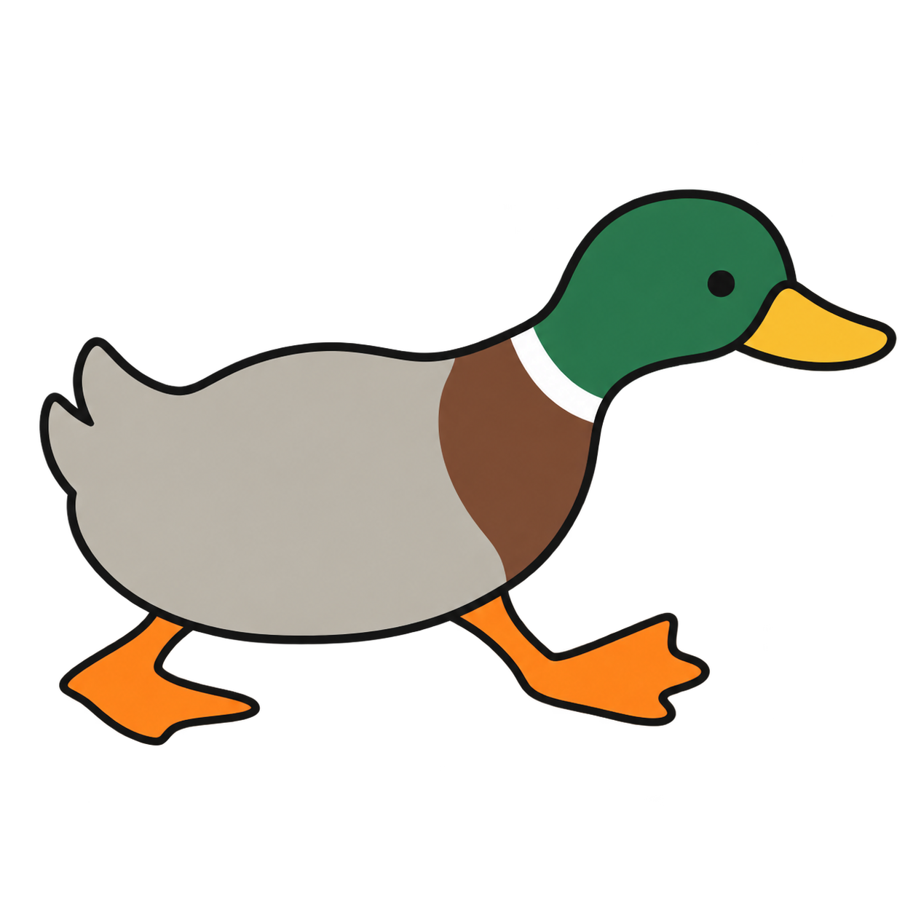

# Mallard



my own browser for macOS. black UI, monospace text, sidebar tabs, and a duck.

i wanted to switch between school and personal accounts without the extra "who's using Chrome?" window. also wanted built-in ad blocking and a browser that looks more like Terminal.

still a work in progress, but it browses actual websites now!

## what's in it

- Personal and School profiles with separate cookies, tabs, bookmarks, and autofill
- sidebar tabs, bookmark folders, and website favicons
- Chrome bookmark import, including folders
- Brave Search, history, downloads, and session restore
- ad and tracker blocking, with a shield button to pause it for a tab
- passwords and cards stored in macOS Keychain, with authentication before filling
- Chrome password CSV import
- a bottom bar for blocked requests, tab/app RAM and CPU, and app download/upload speed in Mbps

the UI is AppKit and Objective-C++. websites run in Chromium through CEF, and the blocker uses Rust.

## building it

currently targets Apple silicon and macOS 26. you'll need Xcode Command Line Tools, CMake, Rust, and Python 3.12 or newer.

```sh
git clone https://github.com/EwoudVV/Mallard.git
cd Mallard
python3 scripts/build.py
open build/Mallard.app
```

quit Mallard before rebuilding. the script downloads the pinned CEF build, checks its checksum, and signs the app locally. it doesn't install anything in Applications or change your default browser.

## still working on

- YouTube playback and ad blocking need more testing
- school sign-in and more real-world autofill testing
- payment fields inside embedded frames
- automatic password-save prompts and editing saved passwords/cards
- private browsing, pinned tabs, and tab folders
- signed releases, notarization, and browser updates

cards can be added manually. importing them directly from Chrome isn't supported yet. there's no extension support or account sync.

[test commands](docs/testing.md) / [third-party components](THIRD_PARTY.md)
